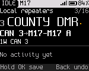
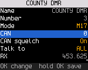
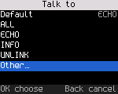
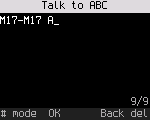
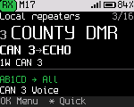
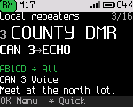
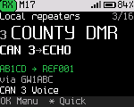

<!-- SPDX-License-Identifier: MIT -->
<!-- Copyright (c) 2026 The RadioFoundry Authors -->

# M17

M17 is a digital mode for direct calls and calls through a gateway. Check the [feature matrix](../feature-matrix.md)
for build availability and radio testing status.

## Set your callsign

1. From Home, press **OK**, **7** (Settings), then **0** (My radio).
2. Move to **M17 callsign** and press **OK**.
3. Enter up to nine characters from A–Z, 0–9, `-`, `/`, and `.`, then press **OK** to save. Lowercase letters
   become uppercase. Spaces are invalid in your own callsign.

In letter mode, a tap on **0** tries a space and shows a warning. Repeated taps leave the callsign as entered.
Hold **0** or switch to **123** mode to enter a zero.

Save an empty entry to use the radio name. The radio skips leading spaces, takes the name up to the first space
or hyphen, and uses that part in uppercase if it is valid. **My radio** shows the resulting callsign.

| When you press PTT | Meaning |
|---|---|
| **M17: set your callsign** | Voice and packet transmissions require a valid callsign. Set one under **My radio**. |
| **M17: receive only** | The radio's M17 hardware path can receive only. |
| **This channel is RX only** | The stored channel is set to receive only. |

## Select M17 in the VFO

1. From Home, press **OK**, **4** (Zones), select the **VFO** row, and press **OK**.
2. Enter the receive frequency.
3. Press **\*** to open Quick settings. Press **4** (Mode) until the mode is **M17**, then press **Back** to return
   Home. The cycle includes M17 when the build and radio support it.

Home shows **M17** in the status strip. The VFO shows the frequency, and a stored channel shows its name. The talk
line shows the configured **CAN**. When the channel allows transmit, an arrow points to the destination PTT will
call. **All** means broadcast. The power line also shows the configured CAN where there is room. See
[The VFO](07-channels-zones-vfo.md#the-vfo).

## Edit a stored channel

1. From Home, press **OK**, **5** (Channels), select a channel, and press **OK**.
2. Move to **Mode** and press **OK** until it shows **M17**.
3. Set **CAN**, **CAN squelch**, and **Talk to** as needed.
4. Hold **OK** on the channel page or choose **Save**.

| Field | How to set it |
|---|---|
| **CAN** | Press **OK**, enter a channel access number from 0 to 15, and press **OK**. A new M17 channel and the VFO start at 0. |
| **CAN squelch** | Press **OK** to toggle it. New stored M17 channels start **On**. The VFO defaults to **Off**. |
| **Talk to** | Press **OK**, enter a callsign or reflector address, and press **OK**. Use up to nine characters from the callsign alphabet, plus spaces inside the address as in `M17-M17 A`. Blank or `ALL` calls everyone. |

You can also set these fields in the [Codeplug Editor](04-programming.md#m17).

## Change who you talk to temporarily

1. On an M17 channel or VFO, press **\***, **8** (Talk to).
2. Use **Up** or **Down** to select **Default**, **ALL**, **ECHO**, **INFO**, **UNLINK**, or **Other…**. Press **OK**.
3. For **Other…**, edit the current destination and press **OK** to apply it. Broadcast opens an empty field.
   Save a blank field or enter `ALL` to call everyone. **Not an M17 address** leaves the editor open for correction.
   **Back** deletes a character or cancels when the field is empty. Hold **Back** where supported to cancel and go Home.
4. Press **Back** from Quick settings to see the destination on Home.

**Default** shows and restores the programmed channel destination or the VFO's base destination. The temporary
choice lasts until you choose **Default**, change the selected channel or VFO frequency, leave M17, select a
different dual-watch pane, or restart. To change the programmed channel destination, use the channel editor.

## Read an incoming call

Every M17 voice stream or packet transmission sends the configured CAN in its initial call setup. Home shows the
incoming call's CAN on the receive line. With **CAN squelch** on, a call on a different CAN stays visible as
**Other CAN**. The filter mutes its speech and drops its packet data. With squelch off, any CAN passes the filter.

Home shows the caller, the addressed destination, and the received CAN and status. **All** on the receive line
means the call was addressed to everyone. If you tune in after the call starts, you may see **…** while the radio
gathers call setup information from the stream. The CAN and status can appear before the caller and destination.
The incoming details clear when the call ends or you retune. See [The Home screen](06-home-screen.md#receiving).

| Status | Meaning |
|---|---|
| **Voice** | The incoming stream declares voice. Codec 2 voice playback is pending in the shipped build. |
| **Voice + data** | The stream declares both voice and data. |
| **Data** | The call carries data. This status alone gives no indication of a user message. |
| **Encrypted** | The call declares encryption. |
| **Other CAN** | The incoming CAN differs from the configured CAN and the filter is on. |

Text sent as call setup metadata (META) appears above the key hints. When a relay supplies the original caller's
callsign, Home shows that caller and names the relay on a **via** line.

